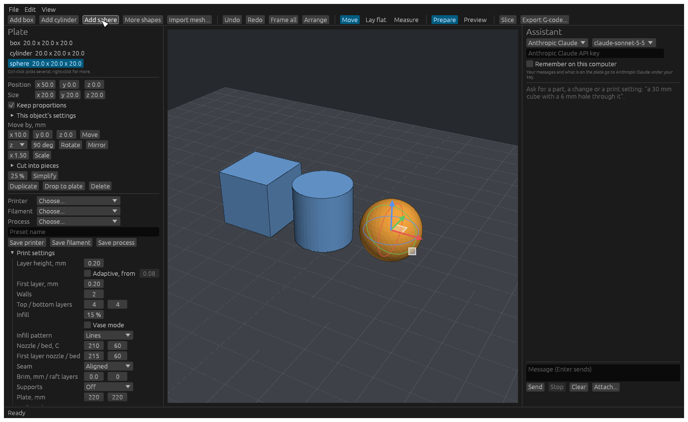

# Lamina

A 3D slicer and modelling tool for 3D printing, in pure Rust, with an AI assistant built in. You describe a part, the assistant
models it, and Lamina slices it to G-code for a real printer.

**Status: early.** The desktop app, a CLI and an MCP server work today: build a plate from primitives or an STL, move objects by dragging them in 3D, rotate
and scale them, join and cut them (`union`, `difference`, `intersect`), slice them to Marlin-style G-code (walls, solid and
sparse infill, skirt, retraction, time and filament estimates), look through the layers, and ask the built-in assistant to do any
of it. A plate and its print settings are saved as a `.lamina` project. Nothing has been printed on real hardware yet. The plan is in [docs/ROADMAP.md](docs/ROADMAP.md).



## Try it

```sh
cargo build --release
target/release/lamina                                      # the desktop app (optionally: lamina part.stl or plate.lamina)
# Or from the command line: model a part and slice it
target/release/lamina-cli run --cmd 'add_primitive {"kind":"cylinder","radius":15,"height":12}' \
                          --cmd 'export_mesh {"path":"part.stl"}'
target/release/lamina-cli slice part.stl part.gcode        # defaults: 0.4 nozzle, 0.2 layers, 220 mm plate
target/release/lamina-cli slice part.stl part.gcode my.json # my.json holds only the settings that differ
target/release/lamina-cli run --cmd slicer_profile         # every setting and its default
target/release/lamina-cli commands                         # every command and its parameters
```

## How it is built

Everything is a command. The CLI, scripts, the MCP server and the AI chat all go through one engine, `Session::execute`, so a
command that fails, panics or leaves the scene invalid changes nothing, and each command's parameters are documented for agents.

- `crates/core`: meshes, the scene, STL files, `.lamina` projects, the command engine.
- `crates/slicer`: layers, walls, infill, G-code, printer profiles.
- `crates/csg`: `union`, `difference` and `intersect` of objects, on csgrs (pure Rust).
- `crates/assistant`: the AI chat (Anthropic, OpenAI, Gemini; your own key). The only crate that touches the network.
- `apps/lamina`: the desktop app, `lamina`: a 3D view of the plate, the objects' tools, print settings, a layer preview and the assistant.
- `apps/lamina-cli`: `lamina-cli` and its MCP server (`lamina-cli mcp`, `--read-only` to let an agent look but not change).

To let an agent outside the app model for you, point your MCP client at `lamina-cli mcp`. The assistant inside the app needs an
Anthropic, OpenAI or Gemini key, typed in its panel or set in the provider's usual environment variable (`ANTHROPIC_API_KEY`,
`OPENAI_API_KEY`, `GEMINI_API_KEY`). Tick Remember to keep it on this computer, sealed in the settings file, and add a passphrase to
encrypt it. Printer and filament presets are in the app's settings panel and, by name, in `slice` and `slice_check`.

## Design notes

Lamina reuses the design of [BIMCraft](https://github.com/IPedrax/BIMCraft), the same author's building-model tool: one command
engine under every front end, hostile input everywhere, no panics. [docs/ARCHITECTURE.md](docs/ARCHITECTURE.md) says what is
ported from it. [docs/RESEARCH.md](docs/RESEARCH.md) is the survey of existing slicers and editors behind the roadmap.

The slicer is clean-room: PrusaSlicer, OrcaSlicer, Bambu Studio and Cura are AGPL or LGPL, so Lamina follows what they document
and never copies their code.

## License

MIT. See [LICENSE](LICENSE).
