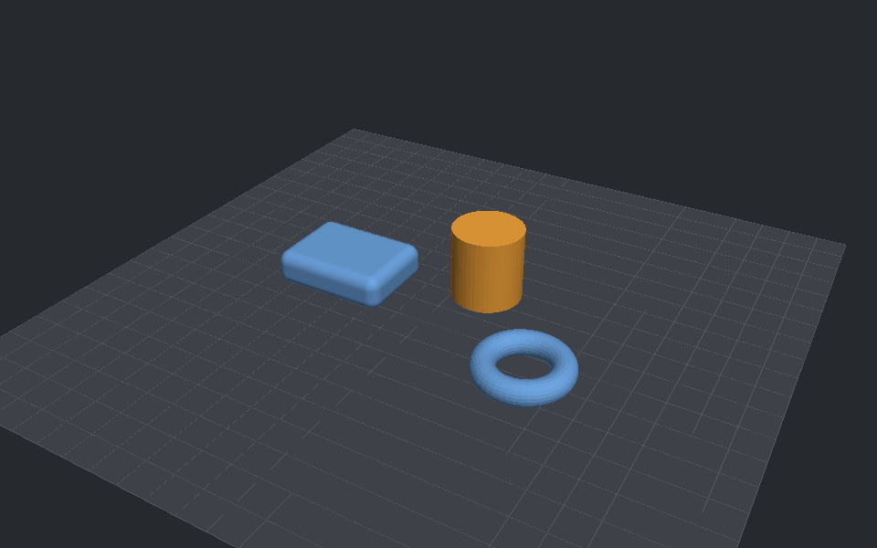
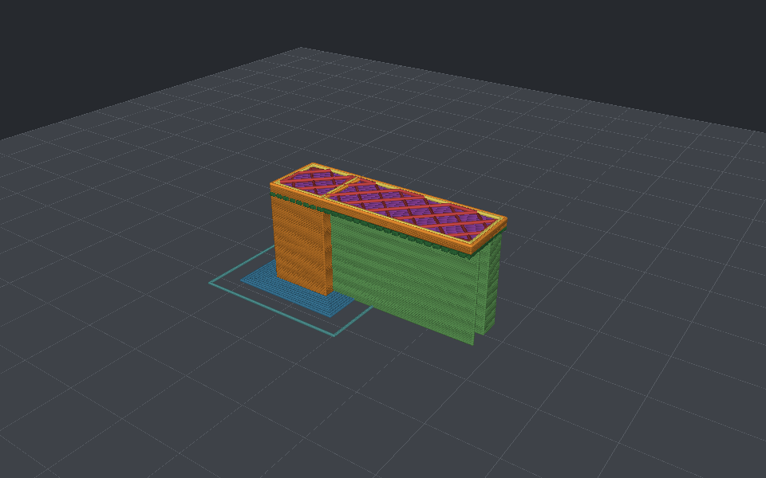

# Lamina user guide

Lamina models parts, slices them for an FDM printer and sends the G-code to it, with an assistant you can ask to do any of it. This
guide covers the window. The command line and the MCP server are in the [README](../README.md).

## Install

Each tagged release has an installer on the [releases page](https://github.com/IPedrax/Lamina/releases): an MSI for Windows, an
AppImage (or a tarball) for Linux, a DMG for macOS. From source, `cargo build --release` makes `target/release/lamina` (the window)
and `target/release/lamina-cli` (the command line).

## Updates

When the window opens, Lamina asks GitHub whether a newer release is out. If one is, a banner under the toolbar says so; nothing is
downloaded until you click Update now. Lamina then downloads the installer for your copy (the MSI on Windows, the AppImage on Linux,
the DMG on macOS) and checks it against the SHA-256 digest GitHub lists for it, refusing any file that does not match. Restart and
install asks you to save any changes, closes the window, puts the new version in place and opens it again with your project. Later
hides the banner until the next start.

A copy that cannot replace itself (a tarball, a build from source, or an MSI installed into a folder other than Program Files) gets a
Download button instead, which opens the release page.

The only addresses Lamina contacts for this are `api.github.com` and GitHub's release download hosts. To stop the check, untick File,
Check for updates at start (File, Check for updates now still asks when you want it to). To keep Lamina from contacting GitHub at
all, set the environment variable `LAMINA_NO_UPDATE_CHECK=1`: the menu items and the banner go away.

## The window

- **The menu bar.** File (new, open, recent, save, import and export, the update check), Edit (undo, redo, the history of steps, duplicate, delete,
  pick all) and View (frame, the theme, the keyboard shortcuts).
- **The toolbar.** Shapes to add, Import mesh, Undo and Redo, Frame all, Arrange, the three tools (Move, Lay flat, Measure),
  Prepare and Preview, Slice and Export G-code.
- **The plate panel, on the left.** The objects on the plate, what can be done to the picked one, the presets, the print settings
  and the printer connection. Hover over any setting to see what it does and its range.
- **The 3D view, in the middle.** Drag to orbit, right-drag or middle-drag to pan, scroll to zoom. Click an object to pick it,
  Ctrl-click to pick several, right-click for a menu.
- **The assistant, on the right.** A chat with a model that drives Lamina with the same commands as the buttons.
- **The status bar, at the bottom.** What the last action did, or why it could not; while slicing or a boolean runs, a spinner, the
  seconds so far and Cancel.

## Your first print

1. **Put a part on the plate.** Import an STL, 3MF, OBJ or glTF file (the toolbar, File, or drop it on the window), add a shape from
   the toolbar, or ask the assistant for a part. An imported mesh with holes or flipped faces is repaired where it can be, and a
   warning sign beside it says what is still wrong; Repair mends what it can.
2. **Choose your printer, filament and process.** The three preset pickers in the plate panel set only their own fields: a printer
   sets the plate, the nozzle and the G-code, a filament its temperatures and fan, a process the layers and the strength. Built in
   are generic Marlin and Klipper printers of 220 to 350 mm and a delta, PLA, PETG, ABS, ASA and TPU 95A, and 0.12 mm Fine, 0.20 mm
   Standard, 0.28 mm Draft and Strong.
3. **Check the settings.** The main ones are in Print settings; the rest are in the groups under it (speeds, retraction and travel,
   the skirt, cooling, support details, the machine, and the start and end G-code). Supports are columns or trees: pick Tree
   beside Supports for branches that gather into a few trunks, less plastic under a tall overhang.
4. **Slice.** Press Slice. The window stays usable while it works, and the Preview tab opens when it is done, with the layer count,
   the filament and the print time.
5. **Look at the preview.** In 3D, every layer up to the one on the slider is drawn, coloured by what it prints: walls, infill,
   bridges, supports, brim and skirt, with a legend. Layer shows that one layer from above, with its travels if you tick Travels.
6. **Print.** Export G-code writes a file for an SD card or USB stick. With a printer connection (below), Send to printer uploads it
   and Send and print starts it.

## Arranging and changing parts

- **Move** (G): drag the arrows to move along an axis, the square to slide on the plate, a ring to turn about its axis, the corner
  square to scale. Moves snap; hold Shift to move freely. The position and size fields under the object take typed numbers.
- **Lay flat** (L): click a face to turn it down onto the plate. **Measure** (M): click two points.
- **R** turns the picked objects 90 degrees, **F** frames them, **A** arranges the plate, **Ctrl+D** duplicates, **Delete**
  deletes. View, Keyboard shortcuts lists them all.
- With one object picked, the panel also has Move by, Rotate, Mirror, Scale, Cut into pieces, Duplicate and Drop to plate. With
  several, Union, Subtract and Intersect. A boolean that cannot give a sound solid says so and changes nothing.
- **This object's settings** lets one object print differently from the rest: its own walls, infill, seam, speeds or supports,
  or its own extruder.

## Several extruders

On a printer with two to eight extruders or a tool changer, set the count in the Extruders group of the print settings, and give
each object its extruder under This object's settings. Each layer prints one extruder's objects, then the next's, so a tool
changes at most once per extruder per layer: the old one retracts and cools to its standby temperature (off once it has nothing
left to print), the new one is chosen with `T` and waited for at its own temperature (Extruder 2 nozzle, and so on; one left
alone prints at the nozzle temperature). After each change the new nozzle wipes and purges on the purge tower, a square you place
with Tower x and y (from the middle of the plate) and Tower size, clear of every object; the tower rises on every layer up to the
last change so it stays solid. The slice says so when the tower is off the plate, over an object, or too small for the purges of
one layer. The tool change G-code, in the Start and end G-code group, runs before each `T`. The firmware applies each tool's
offset; on Klipper, `T0`, `T1` and so on are macros in your printer's config.
- **Undo** takes back a whole step, a drag or a chat turn alike; Edit, History goes back several at once.

## Cutting a part into pieces

Cut into pieces, under the picked object, cuts it with a plane and adds connectors so the printed pieces go back together. Pick the
axis the plane crosses (x, y or z) and move the slider: the plane shows in the 3D view, translucent blue. Then pick the connectors:

| Connectors | What is made | Printing |
|---|---|---|
| Pins (the default) | pegs on one piece and sockets, 0.2 mm a side larger, in the other: nothing loose | the peg piece prints pegs up |
| Dowels | holes in both pieces at the same places, and a loose pin for each pair, 0.2 mm a side smaller than its holes | both pieces can lie on their cut faces; a steel or wooden dowel of the hole's size can replace a printed pin |
| None | nothing: for parts you glue | |

Under the connector type, Shape (round or square), How many, Size and Fit (the gap between a peg or pin and its hole, 0.2 mm a side
by default; more is looser) are yours to set, each on Auto (chosen from the cut face) until you change it.

Two or more connectors are spread across the cut face, so the pieces cannot turn on them; where only one fits it is a square key.
Their size comes from the face (3 to 8 mm across, the holes about one and a half times as deep, never through a wall or the far
end). A face with no room for one is cut without and the status bar says so. Cut turns each piece to print and lays the plate out.

Split to fit plate cuts a part too big for the printer into as few pieces as fit the plate and the printer's height: across its
longest side that does not fit first, in equal pieces, with the connectors chosen at every cut. Each piece is turned onto a cut
face where that leaves it no taller (a piece with pegs stands pegs up), any dowels stand beside them, and the plate is laid out. If the pieces do not all fit on the
plate at once, the status bar says to print them in batches. Undo takes the whole cut or split back.

The assistant has the same two commands (`cut` and `split_to_fit`), and can cut where you say along any axis.

## Presets of your own

Type a name under the preset pickers and press Save printer, Save filament or Save process: it saves the fields that kind of preset
holds, as they are shown. Saved while another preset of that kind is chosen, it keeps only what you changed and follows the rest of
that preset, so a change to it carries over. Your presets are listed under the built-in ones, marked "mine", and kept in the settings file.

## Settings from another slicer

Import profile, under the print settings, reads a PrusaSlicer `.ini` or an OrcaSlicer or Bambu Studio `.json` preset and lays the
settings Lamina also has over the ones shown. The status bar lists what was left out: settings Lamina does not have, values it
cannot take, and start G-code written with the other program's placeholders, which you write again in Lamina's.

## The assistant

Choose a provider (Anthropic Claude, OpenAI or Google Gemini) and give it an API key, or choose On this computer to use a model
running on your own machine (below). The key is used for that session only, unless
you tick Remember: then the settings file keeps it sealed. By default it is sealed under a secret built into Lamina, which scrambles
it but does not protect it from anyone who has Lamina; with a passphrase it is encrypted under that, and you type the passphrase
once a session. A key in `ANTHROPIC_API_KEY`, `OPENAI_API_KEY` or `GEMINI_API_KEY` is used instead of any typed one.

**A model on your own computer.** With Ollama or LM Studio running, choose On this computer, give the server's address
(`http://localhost:11434/v1` for Ollama, `http://localhost:1234/v1` for LM Studio) and the model's name as the server gives it
(`qwen3`, `llama3.2:3b`). Nothing leaves the machine, and no key is needed. Lamina refuses any address that is not this computer.
Choose a model that supports tool calling; small models follow the tools less well than the providers' large ones.

The assistant can model (shapes, outlines extruded into parts, booleans, cuts, arranging), set up and check a slice, and read notes
on design for FDM and on slicer settings. It can look at the plate too: it draws a picture of it to compare a part with a photo you
attached (Attach, under the message box, or drop the picture on the window) or with what you described. It cannot touch files, so it cannot open, save or export anything or send to a printer,
and it cannot start a new plate. Each of its turns is one undo step. Each saved project keeps its own chat (beside the settings,
never in the project file, and never with the key): opening the project brings the conversation back.

## Sending to a printer

Printer connection, in the plate panel, takes the kind of printer, its address and what it asks for to let Lamina in. Lamina
sends only to that address (or port), and only when you press Send.

| Server | Address | Key | Notes |
|---|---|---|---|
| Moonraker | `192.168.1.20` or `http://printer.local:7125` | only if Moonraker asks for one | Klipper, with Mainsail or Fluidd |
| OctoPrint | `http://octopi.local` | its API key (OctoPrint's settings, Application Keys) | |
| PrusaLink | `192.168.1.30` | its API key; or, with User filled in (usually `maker`), its password | the printer's Settings, Network, PrusaLink shows both; the password itself never leaves the computer (HTTP digest) |
| Duet | `192.168.1.40` | the board's password, if it has one | a board running RepRapFirmware on its own, or one run by a single-board computer (DuetSoftwareFramework): Lamina asks which answers |
| USB cable | the port: `/dev/ttyUSB0` or `/dev/ttyACM0` on Linux, `/dev/cu.usbmodem...` on macOS, `COM3` on Windows | none; pick the Baud rate instead (115200 for most, 250000 for some) | Lamina streams the G-code while it prints, so only Send and print works, and the window must stay open until the print is done. Cancel stops it and turns the heaters off |

Bambu Lab printers are not offered: their firmware takes prints from other programs only through Bambu's own software, or in
Developer Mode, and Lamina has no Bambu printer profile yet.

Tick Show what it is doing to see the printer's state, file, progress and temperatures, asked every five seconds (for a printer on a
USB cable, how far the print Lamina is streaming has got: the port is never opened just to ask, as that restarts many boards). The key or
password is kept like the assistant's key: in memory, or sealed in the settings file when Remember is ticked.

## Letting an agent work on your plate

An AI agent outside Lamina (Claude Code, Codex, or any MCP client) can model on the plate you have open. In the plate panel, open
Agents and tick Let agents work on this plate, then point the agent's MCP settings at `lamina-cli mcp --connect`. What it does
appears in the window as it does it, and Undo takes it back. Untick Agents may change the plate to let it only look. An agent can
never start a new plate, open another, or send yours to a printer. Only programs on this computer that can read your settings
folder get in: the window listens on this computer's own address, with a key it writes to `bridge.json` beside the settings.

## Projects and autosave

Save writes a `.lamina` project: the plate, each object's recipe and its own settings, and the print settings and presets chosen.
Open brings it all back. The window asks before New, Open or closing would lose changes. Every two minutes the plate is written to
an autosave beside the settings file; after a crash, the next start offers it back.

## Where Lamina keeps things

The settings file is `settings.json` in `%APPDATA%\Lamina` on Windows, `~/Library/Application Support/Lamina` on macOS and
`~/.config/lamina` on Linux (or wherever `LAMINA_SETTINGS` says). Beside it are the autosave and `lamina.log`, which records each
start, the graphics adapter, errors and crashes: attach it to a bug report.

If the window does not open, look in `lamina.log`. On Windows, a start that died tries another graphics backend the next time
(DirectX 12, then Vulkan, then OpenGL). Setting `WGPU_BACKEND` to `vulkan`, `dx12`, `metal` or `opengl` chooses one yourself.

## Every setting

The same text is the tooltip in the window. The names are the ones a profile file, a project and the assistant use.

<!-- settings:begin -->
| Setting | What it does | Range | Default |
|---|---|---|---|
| `bed` | The plate's size, mm, x then y. |  | 220.0 x 220.0 |
| `origin_center` | Whether the printer's zero is the middle of the plate (most delta printers) instead of its front left corner. |  | false |
| `max_height` | The tallest the printer can print, mm. | 1 to 2000 | 250.0 |
| `pressure_advance` | The filament's pressure advance (linear advance on Marlin), sent at the start; 0 leaves the printer's own. | 0 to 2 | 0.0 |
| `max_acceleration` | The printer's acceleration, mm/s2: the print time estimate plans each move with it. | 10 to 100000 | 1500.0 |
| `junction_deviation` | How fast the printer takes corners (Marlin's junction deviation, mm); used for the time estimate. | 0 to 1 | 0.013 |
| `nozzle` | The nozzle's diameter, mm: lines are this wide, and layers at most 80 % of it. | 0.1 to 2 | 0.4 |
| `filament_diameter` | The filament's diameter, mm, usually 1.75. | 1 to 3.5 | 1.75 |
| `start_gcode` | G-code sent before the print; [name] is replaced by that setting, and {expression} by its value. |  | see the window |
| `end_gcode` | G-code sent after the print; [name] is replaced by that setting, and {expression} by its value. |  | see the window |
| `firmware` | The printer's firmware: Klipper also gets object markers, so one failed object can be cancelled alone. |  | `marlin` |
| `firmware_retraction` | Retract with the firmware's G10 and G11, so the printer's own retraction settings apply. |  | false |
| `thumbnail` | A picture of the plate this many pixels square, for the printer's screen; 0 for none. |  | 0 |
| `layer_height` | The height of each layer, mm: thinner is finer and slower. | 0.02 to 1.6 | 0.2 |
| `first_layer_height` | The height of the first layer, mm: a thicker one sticks better to an uneven plate. | 0.02 to 1.6 | 0.2 |
| `adaptive_layers` | Thin layers where a surface is nearly flat, so its steps hardly show, and thick ones on walls, to save time. |  | false |
| `min_layer_height` | The thinnest an adaptive layer may be, mm; the thickest is the layer height. | 0.02 to 1.6 | 0.08 |
| `ironing` | A second pass over each top surface with a trickle of plastic, which melts its ridges flat; slower, smoother tops. |  | false |
| `ironing_flow` | How much plastic ironing lays, as a share of a full line: 0.1 is usual. | 0.01 to 0.5 | 0.1 |
| `ironing_spacing` | How far apart the ironing lines are, mm: much closer than the line width. | 0.05 to 1 | 0.1 |
| `ironing_speed` | How fast ironing moves, mm/s. | 1 to 300 | 15.0 |
| `fuzzy_skin` | Roughen the outer wall with small random bumps, for a textured grip that hides layer lines. |  | false |
| `fuzzy_thickness` | How far a fuzzy skin's bumps stand in or out, mm. | 0.05 to 2 | 0.3 |
| `fuzzy_spacing` | How far apart a fuzzy skin's bumps are along the wall, mm. | 0.1 to 5 | 0.8 |
| `arc_fitting` | Write curves as G2 and G3 arcs: a smaller file and smoother circles. Klipper needs [gcode_arcs] in its config. |  | false |
| `arc_tolerance` | How far an arc may stray from the points it replaces, mm. | 0.001 to 0.5 | 0.02 |
| `perimeters` | Walls round each layer: more is stronger and slower. | 0 to 10 | 2 |
| `vase` | Vase mode: above the bottom, one wall that climbs without stopping, with no infill and an open top. |  | false |
| `top_layers` | Solid layers that close the top of the part. | 0 to 50 | 4 |
| `bottom_layers` | Solid layers at the bottom of the part. | 0 to 50 | 4 |
| `infill_density` | How much of the inside is filled, from 0 to 1 (the window shows it in %). | 0 to 1 | 0.15 |
| `infill_pattern` | The pattern of the sparse infill: lines, grid, triangles, gyroid or honeycomb. |  | `lines` |
| `skirt_loops` | Loops round the part on the first layer, not touching it, to start the flow; 0 for none. | 0 to 10 | 1 |
| `skirt_distance` | How far the skirt stands from the part, mm. | 0 to 50 | 3.0 |
| `brim_width` | Loops round the first layer, touching it, that hold its edges down, mm wide; 0 for none. | 0 to 50 | 0.0 |
| `raft_layers` | Layers of lines under the part, which is lifted onto them; 0 for none. | 0 to 10 | 0 |
| `perimeter_speed` | How fast walls print, mm/s. | 1 to 1000 | 45.0 |
| `infill_speed` | How fast infill and support print, mm/s. | 1 to 1000 | 80.0 |
| `first_layer_speed` | How fast the first layer prints, mm/s: slower sticks better. | 1 to 1000 | 20.0 |
| `travel_speed` | How fast the head moves when it is not printing, mm/s. | 1 to 1000 | 150.0 |
| `nozzle_temp` | The nozzle's temperature, C. | 0 to 400 | 210.0 |
| `first_layer_nozzle_temp` | The nozzle's temperature for the first layer, C. | 0 to 400 | 215.0 |
| `bed_temp` | The plate's temperature, C; 0 for an unheated plate. | 0 to 400 | 60.0 |
| `first_layer_bed_temp` | The plate's temperature for the first layer, C. | 0 to 400 | 60.0 |
| `retract_length` | How far the filament is pulled back before a travel, mm, so it does not ooze and string. | 0 to 20 | 0.8 |
| `retract_speed` | How fast the filament is pulled back and pushed again, mm/s. | 1 to 200 | 35.0 |
| `retract_min_travel` | A travel shorter than this is made without retracting, mm. | 0 to 100 | 1.5 |
| `combing` | Travel inside the part without retracting, however far: it crosses no gap, so nothing strings. |  | true |
| `z_hop` | Lift the nozzle by this much while it travels, mm, so it does not knock the part; 0 for none. | 0 to 5 | 0.0 |
| `wipe_distance` | Retract while moving back along the line just printed, mm, which leaves a smaller blob; 0 for none. | 0 to 10 | 0.0 |
| `fan_speed` | The part-cooling fan, 0 to 255: off for the first layer, then up in steps to this. | 0 to 255 | 255.0 |
| `fan_full_layer` | The layer from which the fan runs at its full setting. | 1 to 100 | 3 |
| `min_layer_time` | A layer that would print faster than this, s, is slowed so it cools before the next. | 0 to 120 | 5.0 |
| `min_print_speed` | The slowest a layer is slowed to cool, mm/s. | 1 to 100 | 10.0 |
| `seam` | Where each wall starts and ends, which leaves a small mark. |  | `aligned` |
| `bridge_speed` | How fast a bridge (solid infill over air) prints, mm/s. | 1 to 1000 | 25.0 |
| `bridge_flow` | A bridge's flow as a share of the normal flow: under 1 makes thinner strands that sag less. | 0.5 to 1.5 | 1.0 |
| `bridge_fan` | The part-cooling fan while a bridge prints, 0 to 255. | 0 to 255 | 255.0 |
| `support` | Supports under overhangs: off, everywhere, or only those that stand on the plate. |  | `off` |
| `support_angle` | A surface leaning further than this from vertical, degrees, is held up. | 10 to 89 | 45.0 |
| `support_density` | How much of the support's area its lines fill, from 0 to 1. | 0.05 to 1 | 0.15 |
| `support_z_gap` | The space between the top of a support and the part, mm, so it comes away. | 0 to 2 | 0.2 |
| `support_xy_gap` | The space between a support and the part's walls, mm. | 0 to 5 | 0.6 |
| `support_interface_layers` | Denser layers at the top of a support, under the part, for a cleaner underside. | 0 to 10 | 2 |
| `support_style` | Columns under the whole overhang, or trees: thin branches that merge on the way down, less plastic and smaller marks. |  | `columns` |
| `tree_tip_spacing` | How far apart a tree's tips touch the overhang, mm: closer holds a flatter underside. | 1 to 20 | 3.0 |
| `tree_branch_angle` | How far a tree's branches may lean from vertical, degrees, as they gather into trunks and go round the part. | 5 to 60 | 40.0 |
| `tree_max_radius` | The thickest a tree's trunk grows, mm: a branch thickens with the tips it carries and as it goes down. | 1 to 20 | 3.0 |
| `extruders` | How many extruders or tools the printer has; T0 is the first. The firmware applies each tool's offset, and Klipper needs a T0, T1... macro for each. | 1 to 8 | 1 |
| `extruder` | The extruder that prints, from 1: set it for one object to print that object in another filament. | 1 to 8 | 1 |
| `extruder_temps` | The nozzle temperature of each extruder after the first, C, in order; one left out prints at the nozzle temperature. |  | none |
| `standby_temp_delta` | How far an idle extruder cools below its own temperature while another prints, C; it heats again before it prints. | 0 to 300 | 30.0 |
| `toolchange_gcode` | G-code run at each tool change, before the T: [previous_tool], [next_tool] and [layer_z] as well as the settings. |  | none |
| `tower_x` | Where the purge tower's middle stands, mm east of the plate's middle. | -1000 to 1000 | 60.0 |
| `tower_y` | Where the purge tower's middle stands, mm north of the plate's middle. | -1000 to 1000 | 60.0 |
| `tower_size` | The side of the purge tower, a square each tool change purges on, mm; it prints on every layer up to the last change. | 5 to 200 | 20.0 |
| `purge_volume` | Plastic each tool change lays on the purge tower, mm3, so the new nozzle prints clean. | 0 to 1000 | 20.0 |
<!-- settings:end -->
